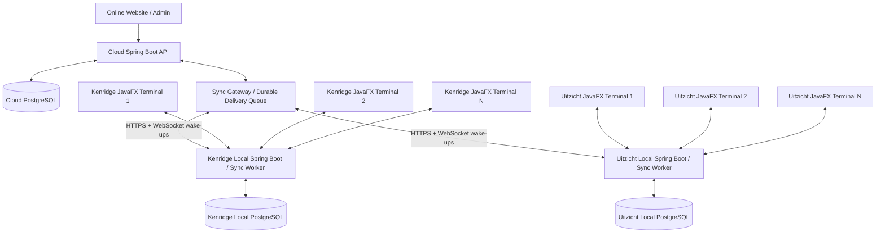

# OnlinePosSystem: Full POS Database Synchronisation Chat

**Topic:** Offline-first, near-real-time synchronisation between local PostgreSQL databases and a hosted PostgreSQL database, with JavaFX POS terminals, authoritative local pricing and order confirmation, and collision-safe order identifiers.

**Format note:** This Markdown archive follows the conversation in order. Visual diagrams and interactive controls from the chat have been converted into Markdown tables, text diagrams, and code blocks so the information remains usable in a `.md` file. The text captures the substantive discussion, design decisions, examples, and follow-up questions.

---

## Turn 1: How should a local database synchronise with a hosted database?

### User

> if I have a local db stored on my pc and a online hosted db what is the best way to sync them

### Assistant

For your **OnlinePosSystem**, where you have a local PostgreSQL database on your PC and another PostgreSQL database hosted online, I would recommend an **offline-first database synchronisation system**.

This allows your local application to continue working even when the internet goes down, then automatically synchronise changes when the connection returns.

#### 1. Recommended architecture

```text
              Online Server
        Spring Boot + PostgreSQL
                  ⇅
           Sync API / Service
    Retry • Deduplicate • Resolve conflicts
                  ⇅
                Local PC
        Spring Boot + PostgreSQL
```

The local and online databases communicate through a secure API, rather than connecting directly to each other's PostgreSQL ports.

**How it works:**

1. **Internet working:** Your application saves changes locally and synchronises them to the hosted database.
2. **Internet goes down:** The local database continues accepting orders and other changes.
3. **Internet returns:** Pending changes automatically upload to the hosted database.
4. **Online changes:** Updated menus, pricing and other relevant information download to the local database.
5. **Conflict handling:** Rules ensure changes are not duplicated or accidentally overwritten.

The important part is that both databases do not necessarily need to be identical at every moment. They become consistent as synchronisation succeeds.

#### 2. Two ways to synchronise PostgreSQL

| Method | Best for | Recommendation |
|---|---|---|
| PostgreSQL logical replication | Mostly one-way database replication | Good for a read-only local copy |
| Spring Boot API synchronisation | Offline use, orders and changes from both sides | **Best for your POS** |

PostgreSQL has built-in logical replication, but when both databases independently write to the same tables, conflicts can occur. It also does not automatically replicate schema changes or sequence state.

#### 3. How I would build your synchronisation system

For a POS application, I would use the following rules:

| Data | Sync direction |
|---|---|
| Orders created locally | Local → Online |
| Website orders | Online → Local |
| Menu items and prices | Online → Local |
| Customer information | Both directions, with conflict rules |
| Stock quantities | Controlled by one authoritative inventory system |
| Order status | Both directions, with controlled state transitions |

**Store pending changes.** When someone creates an order, save the order and its sync event in the same local database transaction.

Example `sync_outbox` table:

```sql
CREATE TABLE sync_outbox (
    id UUID PRIMARY KEY,
    entity_type VARCHAR(50) NOT NULL,
    entity_id UUID NOT NULL,
    operation VARCHAR(20) NOT NULL,
    payload JSONB NOT NULL,
    created_at TIMESTAMPTZ DEFAULT NOW(),
    synced_at TIMESTAMPTZ
);
```

Your Spring Boot application would:

1. Save an order locally.
2. Create its outbox event in the same transaction.
3. Attempt synchronisation automatically.
4. Send pending events to your hosted API.
5. Mark an event as synced only after the server confirms it has committed the change.

The hosted server must also track processed event IDs, so retries cannot create duplicate orders. This is called the **transactional outbox pattern**, combined with idempotent processing.

**Automatic synchronisation.** I would configure your application to attempt syncing approximately every 5 seconds while online, with exponential backoff during failures.

Use HTTPS, authenticate each device, and have the local PC initiate outbound requests so you do not need to expose its database to the internet.

Make sure each order has a globally unique identifier, preferably a UUID, and maintain a separate sync cursor for downloading changes. For deletions, use tombstones or deletion events so the other database knows to remove the record.

#### 4. What happens if the internet goes down?

**Local POS: working offline**

- New orders are saved locally.
- Internet connection unavailable.
- Orders remain pending for synchronisation.

**Connection restored**

- Pending orders upload and online updates download.
- Both databases catch up successfully.

You would also want to test what happens when an upload succeeds but its acknowledgement is lost, the PC restarts mid-sync, or a menu price changes while the PC is offline.

#### 5. Question asked

> Will both databases be receiving changes independently?

Options discussed:

1. Yes, local PC and online server can both create or modify records.
2. No, only the local PC changes data and uploads it online.
3. No, the online database is the main one and the local PC only downloads changes.

This determines whether you need relatively simple one-way replication or a full bidirectional synchronisation system.

---

## Turn 2: The POS must keep working offline

### User

> if the internet goes down the instore pos system still works

### Assistant

Then I would recommend an **offline-first POS system with automatic bidirectional database synchronisation**.

Your in-store POS should **never depend on the internet to process orders**. It should only need the local network and local PostgreSQL database.

#### Recommended architecture

```text
                        Cloud Server
               Website + PostgreSQL
                            │
                     Secure Sync API
                       ↙         ↘
              Kenridge POS   Uitzicht POS
              Local DB        Local DB
              Orders          Orders
              Printers        Printers
```

Each store operates independently offline.

#### How it would work

| Situation | What happens |
|---|---|
| Internet connected | Orders and changes synchronise automatically |
| Internet disconnected | In-store POS continues using local PostgreSQL |
| New in-store order | Saved locally immediately |
| Receipt printing | Continues over the local network or USB |
| Internet restored | Pending changes upload automatically |
| Online website order | Saved in cloud and delivered to store when reconnected |
| Menu price changes | Synchronised to local database when connected |

#### Important design decisions

1. **Local database is the store's operational database.** Creating orders, retrieving menu items and printing receipts must work without calling cloud services.
2. **Cloud database holds the central records.** It receives synchronised orders and manages website orders and centrally controlled menu updates.
3. **Automatic background sync.** A Spring Boot service uploads pending changes and downloads new changes.
4. **Conflict prevention.** Use UUIDs, idempotency keys, record versions and clear data ownership rules.
5. **Offline authentication.** Staff should be able to log in using securely cached local credentials or sessions, even without internet.
6. **Payment limitations.** Cash payments work offline. Card payments depend on whether the payment terminal/provider supports offline transactions.

**One particularly important point:** If the store's internet goes down, your website might still accept online orders, but the store cannot receive them until connectivity returns. You should implement a store connectivity indicator and decide whether to pause online orders or queue them with clear customer messaging.

For your Spring Boot and PostgreSQL system, I would use a **transactional outbox and inbox sync architecture**, rather than trying to keep two writable PostgreSQL databases continuously replicated.

That gives you reliable offline operation without duplicate orders.

**Question asked:** Is your in-store POS a JavaFX desktop application, a browser-based application, or both? This determines how the local server and synchronisation service should be deployed.

---

## Turn 3: Pricing and order confirmation must be authoritative locally

### User

> but changes made to prices to need to update both doesn't matter where the changes were made and also online orders need to be synced in realtime or close to real time as possible to the local db .The local db will the source of truth for prices and order confirmation

### Assistant

For your OnlinePosSystem, I would build a **real-time, bidirectional synchronisation system with the local PostgreSQL database as the source of truth for pricing and order confirmation**.

This is slightly different from traditional database replication because both your website and in-store POS can request changes, but the local database has the final authority.

#### 1. Recommended architecture

```text
             Online Website + API
           Customers and admin users
                       │
               Cloud PostgreSQL
        Orders + price change requests
                       ⇅
             Real-time Sync Service
           WebSocket + HTTPS fallback
                       ⇅
               Local PostgreSQL
           AUTHORITATIVE PRICES
       AUTHORITATIVE ORDER CONFIRMATION
                       │
               In-store POS terminals
```

#### 2. Your three main requirements

| Requirement | How it works |
|---|---|
| Price changed in-store | Local DB updates immediately, then pushes confirmed price to cloud |
| Price changed online | Cloud records a change request, local DB accepts it and publishes the confirmed price back |
| Customer places an online order | Cloud immediately queues the order for the local POS, which confirms or rejects it |

**The crucial distinction:** A price edited online is not yet an authoritative price until the local database accepts the change. Similarly, an online order is not confirmed until the local system confirms it.

This ensures the two databases cannot independently create conflicting authoritative prices or confirmations.

#### 3. Real-time synchronisation

I would use a combination of **WebSockets, HTTPS APIs and a transactional outbox**.

- **WebSockets:** Notify the local server immediately when a new online order or price change is available.
- **HTTPS API:** Retrieve the actual changes, submit acknowledgements and upload local changes.
- **Transactional outbox:** Preserve changes until they have been successfully synchronised.
- **Automatic reconciliation:** Recover missed changes after disconnections, restarts or communication failures.

WebSockets provide speed, while the outbox provides reliability. WebSocket notifications alone are not sufficient because disconnected clients can miss messages.

**Target synchronisation performance when connected:**

- Order notification: **1–3 seconds**, as a design target.
- Recovery polling: **2–5 seconds**, configurable.

These are proposed engineering targets, not guaranteed delivery times. Actual performance depends on network and server conditions.

#### 4. Example: A price changes online

Suppose someone changes a burger from R82 to R89 on your website.

1. Online PostgreSQL records a price change request.
2. The cloud notifies the local Spring Boot application.
3. The local application checks the item's current version and applies the change.
4. Local PostgreSQL becomes authoritative for the R89 price.
5. A confirmation event updates online PostgreSQL.
6. Both applications now display the authoritative R89 price.

If the local database is offline, the online price change stays **pending** until the store reconnects. The website should continue displaying the last confirmed price rather than treating the pending price as active.

If local and online users change the same price simultaneously, the local server resolves the conflict using version numbers and explicit conflict rules, rather than silently overwriting changes.

#### 5. Example: A customer places an online order

1. **Customer submits order online.** Cloud saves order as `PENDING_STORE_CONFIRMATION`.
2. **Cloud sends notification.** Store's WebSocket connection receives an event and the local application fetches the order.
3. **Local PostgreSQL saves and validates order.** Validates authoritative prices, item availability and order details.
4. **Store confirms or rejects order.** Local database records the authoritative decision and its event.
5. **Cloud receives confirmation.** Website displays `CONFIRMED` or `REJECTED` using the store's decision.

A particularly important safeguard is to revalidate online order prices locally. If the cloud had an outdated price, the customer must approve any increased total before payment is finalised. Where supported by the payment provider, authorise payment first and capture only after store confirmation.

#### 6. What if the internet goes down?

| Feature | Offline behaviour |
|---|---|
| Local orders | Fully functional |
| Local price changes | Saved immediately |
| Local receipt printing | Fully functional |
| Online price edits | Queued until reconnection |
| Online orders | Queued in cloud, not confirmed |
| Order confirmation | Only possible locally |
| Reconnection | Automatic catch-up |

The website can continue receiving order requests, but it must clearly distinguish *order received* from *order accepted by store*.

#### 7. Technology I would use

| Component | Technology |
|---|---|
| Local and cloud databases | PostgreSQL 16 |
| Backend | Spring Boot |
| Immediate notifications | WebSocket/STOMP |
| Reliable change delivery | Transactional outbox/inbox |
| Data synchronisation | REST API over HTTPS |
| Conflict handling | Record versions and optimistic locking |
| Missed-event recovery | Cursor-based polling |
| Device authentication | Per-store credentials and TLS |

I would **not** use unrestricted bidirectional PostgreSQL logical replication for this. PostgreSQL documents conflicts when replicated tables also receive independent writes, whereas your business rules need the local POS to make authoritative decisions.

The best approach is to synchronise business events and approved state changes rather than blindly copying database rows.

**Recommendation:** Build one Spring Boot synchronisation service at each store, communicating with your hosted Spring Boot backend. Let the local database own prices and order confirmation, with the cloud maintaining a near-real-time copy and a durable queue for online requests.

That gives you offline reliability, immediate online-order delivery when connected, and consistent pricing with clear ownership.

---

## Turn 4: The local POS uses JavaFX

### User

> the local will be using javfx

### Assistant

Since your in-store POS is built with **JavaFX**, and your online system uses **Spring Boot with PostgreSQL**, I recommend keeping JavaFX as the in-store interface and running a separate local synchronisation service.

This will allow JavaFX to operate completely offline while synchronising with your hosted website as close to real time as possible.

#### 1. Recommended architecture

```text
         Online Website
  Spring Boot + Cloud PostgreSQL
                ⇅
         Real-time Sync
   WebSocket + HTTPS + Outbox
                ⇅
      In-store Local System
       Local Spring Boot
  Sync worker + Local POS API
             ↙    ↘
        JavaFX      PostgreSQL
     POS interface  Source of truth
```

#### 2. What each component does

| Component | Responsibility |
|---|---|
| JavaFX | Orders, pricing management, staff operations, receipt printing |
| Local PostgreSQL | Authoritative prices, orders and order confirmations |
| Local Spring Boot | Local API and automatic synchronisation |
| Cloud Spring Boot | Website, online ordering and cloud API |
| Cloud PostgreSQL | Synced records and pending online requests |
| WebSocket | Immediate notifications in both directions |

**Important:** The local Spring Boot service should start automatically when the PC boots and continue running even when JavaFX is closed.

#### 3. How an online order reaches JavaFX

1. Customer places an order on your website.
2. Cloud PostgreSQL saves it as `PENDING_STORE_CONFIRMATION`.
3. WebSocket notifies the local synchronisation service.
4. The local service downloads and saves the order in local PostgreSQL.
5. JavaFX immediately displays the new order, optionally with a sound notification.
6. Cashier accepts or rejects the order in JavaFX.
7. The decision is committed locally and synchronised to the cloud, updating the customer's order status.

I'd target **1 to 3 seconds** for order delivery under normal network conditions, with automatic polling as a fallback.

#### 4. Price synchronisation

Prices can be edited from either JavaFX or the website.

- **Changed in JavaFX:** Update local PostgreSQL immediately, then synchronise the authoritative price to the cloud.
- **Changed online:** Record a pending price change, deliver it to the local service, validate its version, and commit it locally. Then update the cloud's confirmed price.
- **Changed in both places:** Use revision numbers to prevent older changes from overwriting newer ones.

If the internet goes down, local prices remain fully editable. Online edits remain pending until connectivity returns.

#### 5. What happens when JavaFX closes?

Because synchronisation runs separately, the local server can continue:

- Receiving online orders.
- Saving them into local PostgreSQL.
- Synchronising price changes.
- Uploading locally confirmed orders.
- Reconnecting automatically after internet outages.

When JavaFX opens again, it loads pending orders from the local database. This is preferable to running the entire synchronisation system inside the JavaFX application.

#### 6. Question asked about deployment

> How will JavaFX be installed in each store?

Options discussed:

1. One PC per store, running JavaFX and PostgreSQL.
2. **Multiple JavaFX POS terminals connecting to one local PostgreSQL server.**
3. Multiple PCs, each with its own local PostgreSQL database.

One shared local database per store is generally much easier to keep consistent than having a separate writable PostgreSQL database on every POS terminal.

---
## Turn 5: Multiple JavaFX terminals and full architecture design

### User

> Each store will have multiple JavaFX POS terminals connecting to one central local PostgreSQL database. Design the full offline-first, near-real-time sync architecture with local price and order-confirmation authority.

### Assistant

# Complete architecture: Offline-first JavaFX POS with real-time PostgreSQL synchronisation

**Recommended architecture.** For your OnlinePosSystem, I recommend a **distributed POS architecture with one authoritative local server per store, a central cloud server, and reliable event-based synchronisation**.

This is designed for your two branches, Kenridge and Uitzicht, with multiple JavaFX terminals at each location.

The most important principle is:

**Each store must operate independently of the internet, while the cloud website synchronises with it whenever a connection is available. The local store makes the final decisions about prices and order acceptance.**

### 1. System architecture



Each JavaFX terminal connects to its store's **local Spring Boot API**, not directly to PostgreSQL.

```text
JavaFX Terminal 1 ──┐
JavaFX Terminal 2 ──┼── Local Spring Boot API
JavaFX Terminal 3 ──┘              │
                            Local PostgreSQL
                                   │
                              Sync Worker
                                   │
                              Cloud Server
```

This keeps all terminals consistent, enforces business rules centrally within the store, and simplifies database security.

The sync worker runs as part of the local Spring Boot service, independently of whether any JavaFX terminal is open.

**Technology responsibilities:**

| Component | Responsibility |
|---|---|
| JavaFX POS terminals | Cashier interface, orders, pricing administration, receipts |
| Local Spring Boot | Handles all store operations, permissions, order decisions, local events and synchronisation |
| Local PostgreSQL | Authoritative store data, prices and order confirmations |
| Cloud Spring Boot | Online ordering, website, customer accounts and sync coordination |
| Cloud PostgreSQL | Online order requests, authorised price snapshots and synced records |
| Sync service | Event delivery, acknowledgements, retries and conflict management |

### 2. Which system controls which information?

Instead of allowing both databases to overwrite each other, assign a clear authority for every type of data.

| Data | Authoritative system | Sync behaviour |
|---|---|---|
| Menu prices | Local PostgreSQL per branch | Online edits are requests for local approval |
| Menu item availability | Local PostgreSQL | Local → Cloud |
| Online order submission | Cloud | Cloud → Local |
| Online order acceptance/rejection | Local PostgreSQL | Local → Cloud |
| In-store orders | Local PostgreSQL | Local → Cloud |
| Order preparation status | Local PostgreSQL | Local → Cloud |
| Customer website accounts | Cloud | Selected customer data → Local |
| Staff and store permissions | Policy-controlled | Securely cached for offline operation |
| Product images/descriptions | Configurable central ownership | Cloud → Local after validation |

For example, Kenridge and Uitzicht can have different prices for the same pizza, because each store controls its own authoritative price records.

### 3. Price synchronisation: changes from either side

#### Scenario A: A cashier changes a price in JavaFX

Suppose a pizza changes from R110 to R120.

1. JavaFX sends a price update to the local Spring Boot API.
2. Local PostgreSQL validates the change and commits the new price with a new revision number.
3. All connected JavaFX terminals receive an immediate local WebSocket notification.
4. The same database transaction records a durable `PriceChanged` event.
5. The sync worker uploads that event to the cloud.
6. The cloud updates its confirmed price projection, and the website displays R120.

If internet connectivity is unavailable, steps 1 through 4 still work. The upload happens automatically after reconnection.

#### Scenario B: An administrator changes the price on the website

The cloud cannot independently commit an authoritative price change.

1. Administrator changes a price from R110 to R120.
2. Cloud PostgreSQL creates a `PriceChangeRequested` command, including the price revision on which the edit was based.
3. The local server receives the request through synchronisation.
4. The local server checks the revision and validates permissions and pricing rules.
5. If valid, local PostgreSQL commits R120 and publishes a `PriceChanged` event.
6. The cloud receives the confirmation and activates R120 on the website.

If someone edited the same price in-store first, the online request is flagged as a conflict rather than silently overwriting the newer local price.

**During an internet outage:** An online administrator can submit a proposed price change, but the website continues using the last locally confirmed price until the store accepts it.

### 4. Online orders: near-real-time delivery

For online orders, I would use **WebSocket notifications for speed and persistent HTTP-based synchronisation for reliability**.

1. **Online order submitted:** Cloud saves the complete order as `PENDING_STORE_CONFIRMATION`.
2. **Immediate store notification:** Cloud sends a WebSocket wake-up to the appropriate branch.
3. **Local order import:** The local service fetches the order, checks for duplicates and commits it to local PostgreSQL.
4. **JavaFX notification:** Every relevant in-store terminal can display the new order immediately.
5. **Order validation and confirmation:** The local system validates authoritative prices, item availability and totals. Staff or a defined store policy accepts or rejects the order.
6. **Online confirmation:** The local decision is uploaded, and the website updates the customer's status.

#### Target performance

| Measure | Initial target |
|---|---|
| Online order appears | 1–3 seconds (design target) |
| Fallback polling | 5 seconds (suggested interval) |
| Local POS orders | LAN-only, no cloud dependency |

These are initial performance targets, not guarantees. Confirmation still depends on store processing and, where required, staff action.

The WebSocket notification does not carry the authoritative order or guarantee delivery. It simply tells the store to fetch its durable queued work. This is important because Spring's built-in simple STOMP broker is memory-based and does not offer the acknowledgement and clustering features of a full broker.

### 5. The synchronisation engine

I would implement synchronisation using the **Transactional Outbox + Inbox pattern**, with at-least-once delivery and idempotent processing.

This provides recovery from interrupted requests without losing or duplicating business changes. The outbox pattern commits an event alongside the data it describes, while the inbox prevents repeated events from being applied more than once.

#### Database tables to add

Keep your existing OnlinePosSystem tables and migrations. Add the following infrastructure tables to both local and cloud databases.

| Table | Role |
|---|---|
| `sync_outbox` | Changes committed locally but awaiting delivery acknowledgement |
| `sync_inbox` | Records previously processed event IDs to prevent duplicates |
| `sync_checkpoint` | Tracks the position in the incoming event stream |
| `sync_conflict` | Stores rejected or disputed updates for review |
| `sync_device` | Store identity, authentication and last successful contact |
| `price_change_request` | Tracks pending and resolved website price edits |

On the cloud, also add a durable `sync_delivery` queue for each branch.

#### Example PostgreSQL schema

```sql
CREATE TABLE sync_outbox (
    event_id UUID PRIMARY KEY,
    branch_id BIGINT NOT NULL,
    event_type VARCHAR(80) NOT NULL,
    aggregate_type VARCHAR(50) NOT NULL,
    aggregate_id TEXT NOT NULL,
    aggregate_version BIGINT,
    payload JSONB NOT NULL,
    created_at TIMESTAMPTZ NOT NULL DEFAULT now(),
    acknowledged_at TIMESTAMPTZ
);

CREATE INDEX idx_sync_outbox_pending
ON sync_outbox (created_at)
WHERE acknowledged_at IS NULL;

CREATE TABLE sync_inbox (
    source VARCHAR(50) NOT NULL,
    event_id UUID NOT NULL,
    processed_at TIMESTAMPTZ NOT NULL DEFAULT now(),
    PRIMARY KEY (source, event_id)
);

CREATE TABLE sync_checkpoint (
    branch_id BIGINT NOT NULL,
    stream_name VARCHAR(50) NOT NULL,
    last_sequence BIGINT NOT NULL DEFAULT 0,
    PRIMARY KEY (branch_id, stream_name)
);
```

These are starter tables, not a complete production migration. The outbox worker also needs retry scheduling, error tracking and safe concurrency control.

For incoming cloud events, use a committed, branch-specific sequence. Assign the sequence under a transactional lock when creating the delivery record, so a late-committing transaction cannot be accidentally skipped by the receiver's checkpoint.

The local service processes incoming events in sequence, saving the business change, inbox record and checkpoint together in one database transaction.

For outgoing events, it retries unacknowledged outbox rows until the cloud confirms they have been durably applied.

### 6. Price versioning and conflicts

Every independently editable price needs a version number.

| Product | Price | Version |
|---|---:|---:|
| Cheese Burger, Kenridge | R82 | 14 |
| Cheese Burger, Uitzicht | R85 | 7 |

*Illustrative prices and revisions only.*

When two administrators attempt to edit the same price, use optimistic locking.

```sql
UPDATE menu_prices
SET
    price = 89.00,
    version = version + 1
WHERE id = :price_id
  AND version = :expected_version;
```

If zero rows are updated, the expected version is outdated and the price change must be reconsidered.

For your existing database, I would extend the current price tables rather than create a competing menu-price system.

This includes pizza sizes, extras, burger combinations, promotional pricing and other branch-specific prices.

#### Conflict resolution rules

| Situation | Result |
|---|---|
| Local price changed, no competing change | Commit and sync |
| Online price changed, same expected revision | Accept locally and sync |
| Online edit based on outdated revision | Reject and request review |
| Two JavaFX terminals edit the same price | First successful commit wins |
| Internet disconnects during an edit | Preserve the request and reconcile on reconnect |

Do not use timestamps alone to decide which price wins. Different computers may have inaccurate clocks.

For an online order, also store a snapshot of its quoted prices and revisions. When it reaches the local server, validate the full total, including extras, discounts, tax and delivery fees where applicable.

If there is a price difference that increases the customer's charge, require customer approval before proceeding. Never silently charge a higher amount.

### 7. API design

I would separate the local POS API from the cloud synchronisation API.

#### Local Spring Boot API

JavaFX terminals communicate with these endpoints over the LAN.

| Endpoint | Purpose |
|---|---|
| `GET /api/local/menu` | Retrieve authoritative menu |
| `PUT /api/local/prices/{id}` | Update a price with version checking |
| `POST /api/local/orders` | Create an in-store order |
| `GET /api/local/orders` | Retrieve current and historical orders |
| `POST /api/local/orders/{id}/confirm` | Confirm an order |
| `POST /api/local/orders/{id}/reject` | Reject an order |
| `GET /api/local/sync/status` | Show connectivity and backlog |

#### Cloud synchronisation API

These endpoints are authenticated server-to-server operations.

| Endpoint | Purpose |
|---|---|
| `POST /api/sync/events` | Upload local events |
| `GET /api/sync/events?after={cursor}` | Download queued cloud events |
| `POST /api/sync/ack` | Acknowledge durably processed cloud events |
| `POST /api/sync/heartbeat` | Update branch connectivity |
| `GET /api/sync/bootstrap` | Obtain initial synchronisation data |

These paths are proposed additions, not claims about endpoints already existing in your repository.

An event should carry a unique event ID, branch ID, event type, aggregate identifier, revision, originating system, schema version and payload.

### 8. JavaFX implementation

Every terminal needs its own local API client.

```text
JavaFX POS Application
│
├── AuthenticationService
├── MenuService
├── OrderService
├── PricingService
├── LocalApiClient
├── LocalWebSocketClient
├── ReceiptPrinterService
└── ConnectivityStatusService
```

When one cashier confirms an order or changes a price, the local Spring Boot service updates PostgreSQL, then broadcasts a notification to the other terminals.

JavaFX should receive notifications on a background thread and dispatch UI changes through `Platform.runLater(...)`.

The terminal must also reload relevant data after a reconnect, so a missed WebSocket notification cannot leave its displayed prices permanently outdated.

**No JavaFX terminal should run its own cloud sync worker.** One sync worker per store is sufficient and avoids three terminals racing to import or upload the same events.

### 9. Internet and server failure behaviour

This is where offline-first architecture becomes especially important.

| Failure | Expected behaviour |
|---|---|
| Store internet down | All JavaFX terminals still work locally |
| Cloud unavailable | Local ordering, menus and printing continue |
| WebSocket disconnects | Durable HTTP polling continues or resumes |
| JavaFX terminal crashes | Other terminals remain functional |
| Local Spring Boot restarts | Terminals temporarily reconnect; pending events remain in PostgreSQL |
| Local PostgreSQL unavailable | Store POS cannot safely process orders until local database service recovers |
| Store reboots | PostgreSQL and Spring Boot start automatically; sync resumes |
| Duplicate sync event | Unique event ID prevents duplicate processing |
| Cloud acknowledgement lost | Event is retried without applying it twice |

#### When a store loses internet

I would make the cloud track each store's last heartbeat.

A reasonable initial configuration is a heartbeat every 10 seconds and an offline warning after approximately 30 seconds without successful contact.

When the store is offline, the website should:

- Continue displaying its last confirmed menu prices, marked as potentially outdated if necessary.
- Show the store as unavailable for immediate order confirmation.
- Preferably pause checkout for that branch, while allowing customers to browse.
- Optionally accept explicitly unconfirmed order requests into a queue, with a customer-visible timeout and cancellation policy.

These behaviours should be configurable by branch.

Crucially, **the cloud must never automatically assume authority over local prices or order confirmations just because the store is offline**. Doing so could create conflicting decisions when connectivity returns.

### 10. Security and reliability

For production, I would use the following controls.

| Area | Recommendation |
|---|---|
| Cloud communication | Outbound HTTPS/WSS connections initiated by the store |
| Authentication | Unique per-store credentials or certificates |
| JavaFX access | Authenticate staff against local Spring Boot |
| PostgreSQL access | Only local Spring Boot connects to its database |
| Network | Isolated POS LAN/VLAN, firewall and reserved server IP |
| Permissions | Branch-scoped authorisation, including price editing |
| Auditing | Record who changed prices, who confirmed orders and when |
| Backups | Automatic local PostgreSQL backups and tested off-machine recovery |
| Power | UPS for local server, network equipment and critical terminals |
| Monitoring | Heartbeats, event backlog, sync latency and failed events |

I would use a dedicated local server with an SSD at each branch. It could run Ubuntu with PostgreSQL and Spring Boot managed through Docker Compose or systemd.

For protection against local server failure, use PostgreSQL backups with write-ahead-log archiving and periodically test restoring them. PostgreSQL 16 supports point-in-time recovery using base backups and archived WAL records.

A local server outage is different from an internet outage. Since your local database owns critical decisions, losing that server makes it impossible for the store to keep operating normally unless you add local failover.

### 11. Suggested synchronisation settings

Initial configuration proposed in the chat:

| Setting | Default suggestion | Adjustable range described |
|---|---|---|
| Fallback polling | 5 seconds | 1–15 seconds |
| Store heartbeat | 10 seconds | 5–30 seconds |
| Maximum sync batch | 100 events | 25–250 events |
| WebSocket | Enabled | Enabled |
| Idempotency | Enabled | Enabled |
| Local price authority | Enabled | Enabled |
| Local order-confirmation authority | Enabled | Enabled |

Illustrative YAML configuration:

```yaml
sync:
  fallback-poll-seconds: 5
  heartbeat-seconds: 10
  batch-size: 100
  websocket-enabled: true
  idempotency-enabled: true
  local-price-authority: true
  local-order-confirmation-authority: true
```

These configuration keys are illustrative for a custom Spring Boot configuration class. They are not existing settings automatically recognised by the current codebase.

The worker should also reconnect using exponential backoff with jitter, perform an immediate sync after WebSocket reconnection and maintain separate retry handling for transient and permanent errors.

### 12. Implementation roadmap

1. **Build the local store backend.** Centralise JavaFX access through local Spring Boot and PostgreSQL. Ensure all terminals function without internet.
2. **Implement the event infrastructure.** Add transactional outbox, inbox, delivery queues, version checks and durable acknowledgements.
3. **Synchronise online orders.** Import cloud orders, notify JavaFX terminals, and upload authoritative store confirmations.
4. **Synchronise pricing.** Upload local changes immediately. Add cloud price proposals and local conflict resolution.
5. **Implement reconnection and monitoring.** Add WebSocket wake-ups, fallback polling, backlog recovery and branch health reporting.
6. **Test production failure scenarios.** Simulate internet loss, terminal crashes, interrupted transactions, duplicate events, server restarts and simultaneous price edits.

Before production rollout, I would make these acceptance tests mandatory: an internet outage cannot stop local orders, every submitted online order is eventually either processed or explicitly expired, duplicate event delivery never creates duplicate orders, conflicting prices never overwrite silently, and reopening JavaFX always reloads authoritative store state.

#### Final architecture decision

For your two-store system, **I would not implement direct bidirectional PostgreSQL replication between the cloud and local databases**. PostgreSQL documents conflicts when replicated tables also receive independent writes.

Instead, I would deploy:

- **Cloud Spring Boot + PostgreSQL:** Website, online submissions, cloud price projection and sync delivery queue.
- **One local Spring Boot + PostgreSQL per branch:** Authoritative pricing, order decisions and local synchronisation.
- **Multiple JavaFX terminals per branch:** All access the same local API over the LAN, with instant local updates.

This gives you **in-store independence from the internet, centralised pricing authority per branch, online administration of prices, and near-real-time delivery of online orders**, with durable recovery when either side loses connectivity.

---

## Turn 6: Prevent numeric order ID collisions

### User

> we need a way to sync order ids as deliveries and instore ids might overlap

### Assistant

Exactly. This is an important issue for your POS architecture because **online orders, deliveries and in-store orders could all generate the same numeric ID independently**.

The solution I recommend is to use **UUIDs for synchronisation and numeric order IDs for local database operations and receipts**.

### 1. Use two different order identifiers

Every order should have:

- **`id` (BIGINT):** The database's internal, auto-incrementing order ID. It can differ between the local and cloud databases.
- **`sync_id` (UUID):** A globally unique identifier that remains identical across both databases.

For example:

| Order | Local DB ID | Cloud DB ID | Sync ID |
|---|---:|---:|---|
| In-store order | 152 | 891 | `a73f...91c2` |
| Online delivery | 153 | 152 | `b84d...72a1` |
| In-store order | 154 | 892 | `c95e...38f4` |

Notice that **152 exists in both databases but refers to different orders**. This is perfectly safe because synchronisation uses the UUID, not the numeric ID.

### 2. How orders are synchronised

```text
        Online delivery order
             Cloud ID: 152
       Sync UUID: b84d...72a1
                  │
        UUID preserved on sync
                  ↓
          Local PostgreSQL
       Creates local ID: 153
       Sync UUID: b84d...72a1
                  │
      Local confirms order using
            the same UUID
                  ↓
        Cloud updates original
              order 152
        No duplicate created
```

The local database never needs to adopt the cloud's numeric ID. It simply stores the same `sync_id` and assigns its own `id`.

### 3. Database changes

Since your OnlinePosSystem already has a `customer_order` table, I would extend that table instead of replacing its primary key.

```sql
ALTER TABLE customer_order
ADD COLUMN sync_id UUID;

-- Backfill existing orders only after reconciling
-- records already shared between cloud and local.

UPDATE customer_order
SET sync_id = gen_random_uuid()
WHERE sync_id IS NULL;

ALTER TABLE customer_order
ALTER COLUMN sync_id SET DEFAULT gen_random_uuid(),
ALTER COLUMN sync_id SET NOT NULL;

CREATE UNIQUE INDEX uq_customer_order_sync_id
ON customer_order (sync_id);
```

**Migration warning:** If an existing order is already present in both databases, do not generate two independent UUIDs for it. First match those existing records and assign the same UUID. Otherwise, synchronisation could mistake them for two different orders.

For new orders, the generating system creates the UUID once and includes it in every sync event.

### 4. Prevent duplicate orders during synchronisation

Suppose the cloud sends order `b84d...72a1` to Kenridge. The store successfully saves it, but the connection drops before acknowledging receipt.

The cloud tries again.

The local database should recognise the existing UUID and not create another order.

For example:

```sql
INSERT INTO customer_order (
    sync_id,
    branch_id,
    status
)
VALUES (
    :sync_id,
    :branch_id,
    'PENDING'
)
ON CONFLICT (sync_id)
DO NOTHING;
```

This is a simplified example. The complete implementation must also handle order items, extras, payments and order confirmation events transactionally, with separate event idempotency checks.

### 5. Receipt numbers should be separate

I would also introduce a human-readable `order_reference`.

For your two branches:

| Order reference | Meaning |
|---|---|
| `KEN-POS-000152` | Kenridge in-store order |
| `KEN-WEB-000152` | Kenridge online order |
| `UIT-POS-000152` | Uitzicht in-store order |
| `UIT-WEB-000152` | Uitzicht online order |

The prefixes make references distinguishable even when their numeric portions overlap.

These display references must be generated using the appropriate atomic counter, not calculated from `MAX(id) + 1`.

For an online order, its cloud-issued reference remains stable. The local store may additionally assign its own internal ticket number when it imports the order.

### 6. My recommended order table structure

| Column | Type | Purpose |
|---|---|---|
| `id` | BIGINT | Local database primary key |
| `sync_id` | UUID | Global order identity |
| `branch_id` | BIGINT | Kenridge or Uitzicht |
| `order_reference` | VARCHAR | Human-readable reference |
| `order_source` | VARCHAR | `ONLINE` or `IN_STORE` |
| `fulfilment_type` | VARCHAR | `DELIVERY`, `COLLECTION` or `DINE_IN` |
| `status` | VARCHAR | Current order state |
| `version` | BIGINT | Order revision for safe updates |
| `created_at` | TIMESTAMPTZ | Original creation time |

The distinction between `order_source` and `fulfilment_type` matters. A delivery is not necessarily an online order, since staff might enter a telephone delivery order directly into JavaFX.

For order items and extras, keep local foreign keys pointing to the local order `id`, while sync payloads reference the order using `sync_id`.

### 7. Final synchronisation rules

1. Each new order gets one UUID when it is first created.
2. Local and cloud PostgreSQL generate their own numeric IDs.
3. All order synchronisation references the UUID.
4. The same UUID can never create two local orders.
5. Order confirmations are linked to the UUID and originate from the authoritative store.
6. Customer-visible order references are separate from internal database IDs.
7. Each branch only processes orders assigned to that branch.
8. Existing orders and their related items must be reconciled during the initial migration.

**Recommendation for OnlinePosSystem:** Keep your existing BIGINT primary keys, add an immutable `sync_id UUID NOT NULL UNIQUE`, and implement idempotent synchronisation around that UUID.

This gives you globally unique order identity without needing the internet to allocate an ID, and it avoids breaking existing database foreign keys or JavaFX code that relies on numeric order IDs.

---

## Turn 7: Request to export the discussion

### User

> put all the chat into a md file

### Assistant

This file is the Markdown export of the discussion above. Visual and interactive elements have been adapted to standard Markdown and text diagrams for portability.

---

## Consolidated final decisions from the chat

This final section summarises the decisions already discussed and does not introduce a competing design.

- **Stores:** Kenridge and Uitzicht, with one local server and PostgreSQL database per branch.
- **POS clients:** Multiple JavaFX terminals per branch connecting to the same local Spring Boot API over the LAN.
- **Offline-first:** Local orders, menu queries, prices, cashier login and LAN/USB receipt printing remain usable without internet, assuming the local server and network are working.
- **Authority:** The local branch PostgreSQL database controls current prices, availability, order acceptance/rejection and authoritative order status.
- **Cloud:** Spring Boot, PostgreSQL and website accept order submissions and price-change proposals, distribute events, and display confirmed projections.
- **Synchronisation:** Outbox/inbox events, durable branch-specific delivery queues, WebSocket wake-ups, authenticated HTTPS APIs, polling fallback, acknowledgements and retry with backoff.
- **Performance:** Near-real-time targets of 1–3 seconds for order visibility in healthy conditions and fallback polling around 5 seconds, not hard guarantees.
- **Price changes:** May originate from the cloud or local JavaFX; all effective prices are committed and versioned locally before the cloud displays them as confirmed.
- **Order confirmation:** A cloud order is `PENDING_STORE_CONFIRMATION` until the branch's local system accepts or rejects it. Quoted prices must be validated locally.
- **Collision-safe IDs:** Every order has its own database-local numeric `id` and a stable global UUID `sync_id`, plus optional human-facing order references such as `KEN-WEB-000152`.
- **Deduplication:** `sync_id` and event IDs prevent retries from creating duplicate orders or processing identical events twice.
- **Security:** Outbound store-initiated encrypted connections, per-store identities, locally enforced staff permissions, and no direct database exposure to the internet.
- **Resilience:** Backups, a UPS, service auto-start, event monitoring, durable restart/recovery and explicit testing of conflicts, drops and failure states.

